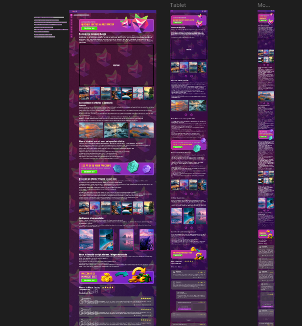

# Responsive Pixel-Perfect Layout Exercise

## Project Overview

This repository contains a responsive webpage implementation based on a design mockup provided as part of a front-end development assignment. The reference included desktop, tablet, and mobile layouts.

## Requirements

- Recreate the supplied design as closely as possible.
- Adapt the page layout for different screen sizes.
- Deliver the implementation as two files: `index.html` and `style.css`.

## Deliverables

- `index.html` — page structure and content
- `style.css` — styling and responsive layout

## Outcome

The page was completed on schedule and in accordance with the assignment requirements. The supplied mockup was used as the visual reference for the implementation.

https://oxana88.github.io/agava-test/
